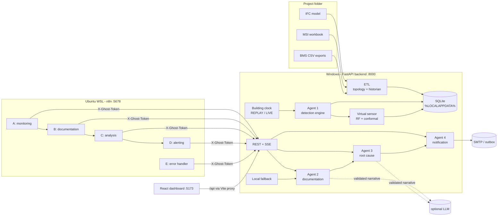

# Architecture

## Components

The backend owns all authoritative state: sensor states, incidents, reports, analyses, predictions,
notifications, and agent runs. n8n orchestrates but never stores truth. Each layer degrades
independently:

| Unavailable | Effect | Core monitoring |
|---|---|---|
| n8n | Agents 2–4 run through the local fallback after `GHOST_LOCAL_FALLBACK_AFTER_S`; a `LOCAL_FALLBACK` event is logged | continues |
| LLM | Reports and analyses are produced without a narrative; the agent run records "LLM unavailable" | continues |
| ML model | Virtual sensors return `INSUFFICIENT` with a reason; detection is unchanged | continues |
| SMTP | Notifications move to `PENDING` with exponential backoff, then `FAILED` after 4 attempts | continues |

## Building clock and readings

* **REPLAY**: building time = anchor + (wall time − anchor time) × speed. A bucket counts as received once building time passes `ts + resolution`. Jumps move forward only; a reset (operator, typed confirmation) restarts the replay.
* **Simulated faults** (`SILENCE`, `NULL_VALUES`, `OFFSET`, `SPIKE`) are an overlay applied at read time. Historian rows are never modified. Anything a fault touches is flagged `simulated`, including incidents, readings, and emails (`[SIMULATED]`).

## The four agents

All agent outputs are Pydantic-validated (`backend/ghost/agents/schemas.py`) before persistence.
Every execution is recorded in `agent_runs` with its trigger (`engine`, `n8n`, `local-fallback`,
`operator`) and the n8n execution ID.

### Agent 1 — detection and classification (`engine/detection.py`)
Runs deterministically, with no LLM, on every new 15-minute bucket of building time, or when n8n
calls `POST /api/automation/detect`.

* **Connectivity** comes from heartbeat age, configured per sensor: temperature/CO₂ are stale after 45 min and offline after 2 h; occupancy/energy after 3 h / 12 h. A transmitted-but-empty value means `INVALID`, which is distinct from silence. Zero is a valid value.
* **Group detection:** ≥ 5 sensors falling silent within 30 minutes form one GROUP incident (no alert storm). Severity is HIGH, or CRITICAL when ≥ 25% of a sensor type is silent.
* **Value rules** (`config/detection.json`):
  * plausible range;
  * spike (one-bucket step not mirrored by neighbours);
  * drift (24 h offset to neighbours vs a 14-day baseline);
  * environmental (same-hour robust z-score, plus whether neighbours also deviate);
  * CO₂ thresholds;
  * energy (same weekday/hour robust z over 4 weeks);
  * topology (sensors with no room).
* **Idempotency:** event ID = hash(dedup key, onset), and at most one open incident per dedup key (unique partial index). Re-detection updates counters. Significant changes (severity increase, STALE → OFFLINE, ≥ 5 sensors joining) bump `pipeline_version`, which triggers re-processing.
* **Recovery:** an incident auto-resolves (`SYSTEM:auto-recovery`) only on genuine recovery. Silence incidents need the sensor transmitting again; value or validity incidents need a fresh valid physical reading. A sensor that switches to a different failure keeps its incident open.

### Virtual sensor — Ghost Sensor ML (`ml/`, `engine/virtual.py`)
* **Random Forest** trained on *residuals* to a physical reference (persistence adjusted by the neighbours' change, or neighbour mean + room offset, …), which keeps predictions anchored outside the training temperature range.
* **Features** are built by one vectorised function shared by training and serving: weighted neighbours (shared wall length + doors), vertical neighbours, floor and building means, last valid value, gap length, 7-day room offset, time, and static room attributes.
* **Inputs are physical readings only**, so inferred values never feed other inferences (no recursive propagation).
* **Uncertainty:** split-conformal 90% interval per (gap length × neighbour availability) bin, calibrated on 15 days held out from training.
* **Quality:** `GOOD`, `DEGRADED` (reasons listed), or `INSUFFICIENT` (no value).
* **Evaluation** (MAE/RMSE vs four baselines, by gap, unseen rooms) is in [MODEL_CARD.md](MODEL_CARD.md).

### Agent 2 — documentation (`agents/documentation.py`)
Builds a structured report from stored evidence. It contains the scope, transmission state,
evidence E1..En, thresholds, baselines, adjacent rooms, virtual-sensor values with intervals,
investigation notes, related incidents, the timeline, and provenance. It renders the report to
Markdown/HTML, and HTML prints to PDF.

Versions are keyed by a content hash, so re-running on an unchanged incident is a no-op. It also
moves an incident from OPEN to INVESTIGATING. An optional LLM narrative is accepted only if it
passes three checks; otherwise it is rejected and the run is marked `INVALID_OUTPUT`:
1. It matches the JSON schema.
2. It cites existing evidence IDs.
3. It contains no number absent from the evidence (grounding check).

### Agent 3 — root cause, risk, recommendations (`agents/analysis.py`)
Separates **facts** (stored observations), **statistical findings** (historian-derived), and
**hypotheses**.

* **Hypotheses** come from rule-based checks with weighted supporting and contradicting evidence. Codes: `DATA_PIPELINE`, `GATEWAY_NETWORK`, `POWER_INTERRUPTION`, `SENSOR_HARDWARE`, `POINT_CONFIGURATION`, `CALIBRATION_DRIFT`, `LOCAL_HVAC_*`, `SHARED_HVAC_ZONE`, `OCCUPANCY_VENTILATION`, `ABNORMAL_LOAD`, `DATA_MAPPING`, …
* **Evidence used:** BMS namespace silence ratios, acquisition stations from the MSI sheet, storeys, energy meters still consuming, neighbour states, room equipment.
* **Score:** a *rule-support score*, explicitly **not a probability**. The UI shows STRONG/MODERATE/WEAK.
* **Recurrence risk:** an empirical Poisson rate from past silence episodes in the historian (≥ 3 episodes required, otherwise "no quantitative estimate").
* **Escalation risk:** virtual-sensor degradation by gap length, taken from validation.
* **Shared cause:** reports other concurrent open incidents of the same category.
* **Recommendations:** advisory, each with urgency, expected impact, and validation method. Nothing is executed on building systems.
* **Human review:** people confirm or reject hypotheses and mark recommendations ACCEPTED/DONE/DISMISSED. Outcomes are stored for analytics.

### Agent 4 — alerting (`agents/notification.py`)
* **Policy** (`config/notification.json`): INFO/LOW dashboard only, MEDIUM optional email, HIGH email, CRITICAL email + one escalation if not acknowledged within 30 min.
* **Dedup:** keyed on `(incident, kind, severity)`. Kinds: `ALERT`, `ESCALATION`, `ACKNOWLEDGED`, `RESOLVED` (sent only if an alert went out).
* **Storm protection:** ≤ 12 emails/hour, and no re-alert for the same incident within 1 hour.
* **Delivery truth:** `TEST_MODE` (written to the outbox, never "sent"), `SENT` only when the SMTP server accepted the message for all recipients, `PENDING` (retry with backoff: 30 s × 2ⁿ, ≤ 15 min, 4 attempts), `FAILED`, `SUPPRESSED` (with reason). Every attempt is logged; recipients are masked in storage and the API.

## n8n workflows (`n8n/workflows/`)

| | Trigger | Steps |
|---|---|---|
| **A** Sensor Monitoring | every minute, plus an authenticated webhook `POST /webhook/ghost-sensor/incidents` | Config → `POST /api/automation/detect` (incremental: only new buckets) → `POST /api/automation/claim` (atomic, limit 5) → split → Execute B |
| **B** Documentation | Execute Workflow Trigger | `POST /api/agents/documentation` → validate → Execute C (invalid output → logged event) |
| **C** Root-Cause Analysis | Execute Workflow Trigger | `POST /api/agents/analysis` → validate → Execute D |
| **D** Email Alerting | Execute Workflow Trigger | `POST /api/agents/notification` → validate → result |
| **E** Error Handling | Error Trigger | sanitise (message ≤ 500 chars, no payloads) → `POST /api/automation/events` |

**Loop safety:** agent endpoints never call n8n. The backend's only call to n8n is the optional
webhook push after detection, and Workflow A's detect is a no-op if the bucket was already evaluated.

**Idempotency:** the claim protocol (claimed_by / claimed_real, stale-claim takeover after 2× the
fallback delay), `processed_version` vs `pipeline_version`, and content-hash report/analysis
versions. Sub-workflows accept calls only from their parent (`callerPolicy`). Every HTTP node has
a timeout and bounded retries.

## Data model (SQLite, `backend/ghost/migrations/`)

`buildings`, `storeys`, `rooms` (footprint, space_kind, stations), `room_adjacency` (WALL / DOOR /
VERTICAL plus the geometric justification), `room_equipment`, `sensors` (thresholds,
station + provenance), `measurements` (bucketed historian; `n_samples` / `n_valid` distinguish
silence from invalid), `fault_injections`, `sensor_state`, `virtual_predictions` (value, interval,
quality, inputs, model version, actual value when known), `incidents`, `incident_sensors`,
`anomaly_events`, `incident_timeline`, `incident_reports`, `analyses`, `hypotheses`,
`recommendations`, `agent_runs`, `notifications`, `notification_attempts`, `workflow_events`,
`system_state`.

Timestamps are Unix seconds UTC. `_ts` columns are building time; `_real` columns are wall-clock
time. Migrations are numbered and applied idempotently at start-up and by the ETL.

## Security

* **Three access levels:** anonymous read (`GHOST_ALLOW_ANONYMOUS_READ`, local development), operator Bearer token (all mutations; the operator's name is recorded in the audit trail), and the automation token `X-Ghost-Token` (n8n). All tokens are compared in constant time.
* **CORS** is restricted to `GHOST_CORS_ORIGINS`. Request bodies are capped (`GHOST_MAX_BODY_BYTES`), mutations are rate-limited (120/min per client), Pydantic models reject unknown fields, and all SQL is parameterised.
* **Secrets** live only in `.env` (git-ignored) and n8n credentials. Workflow JSON contains no secrets, and the error workflow forwards sanitised messages only (keys such as `password` and `token` are redacted).
* **Destructive actions** need confirmation: the reset requires typing `RESET`, and status changes and fault injection go through confirmation dialogs.
